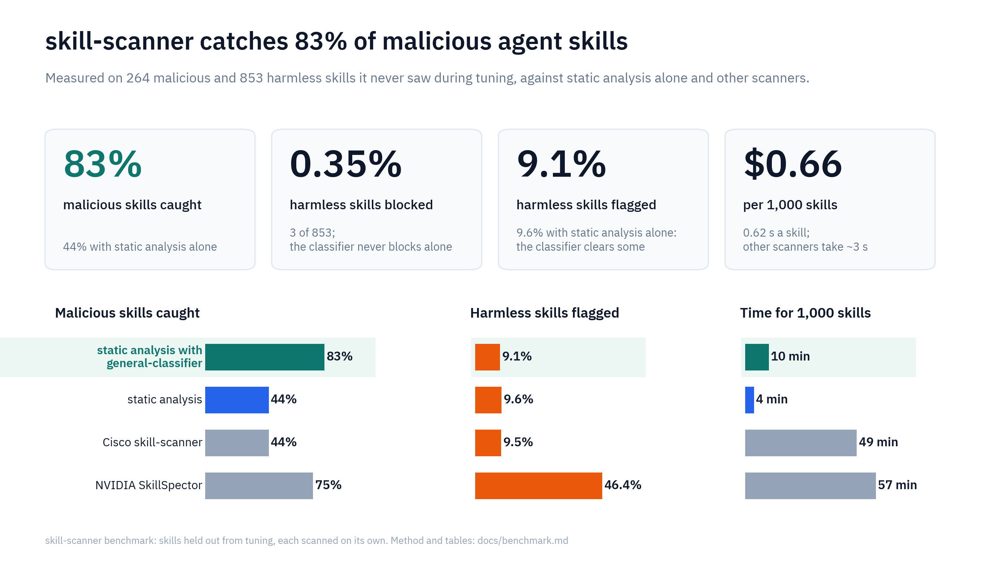
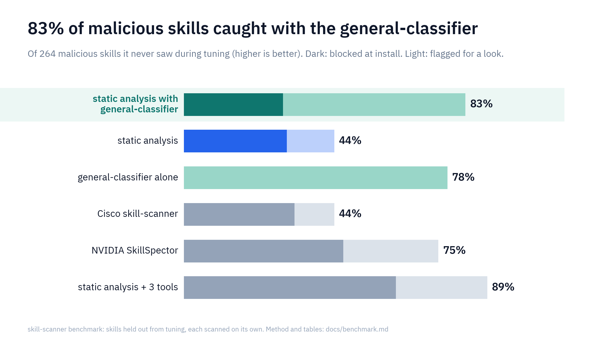
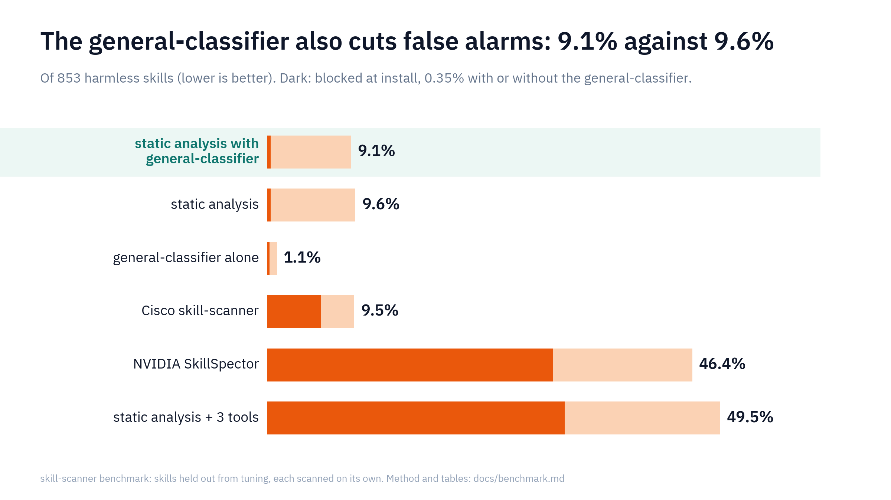
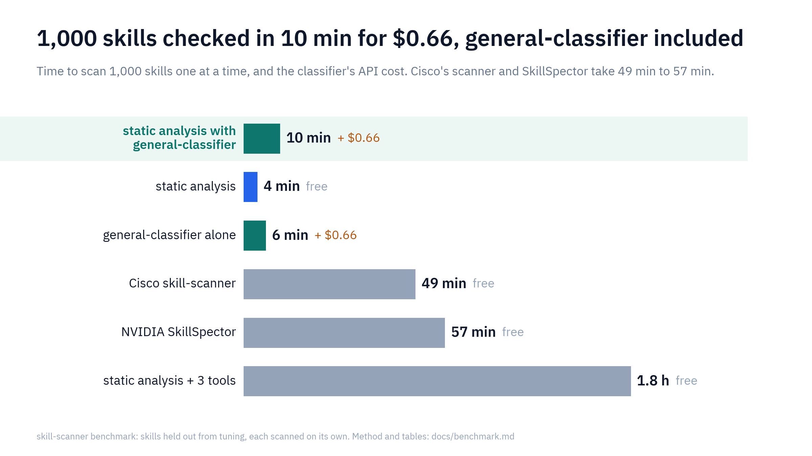
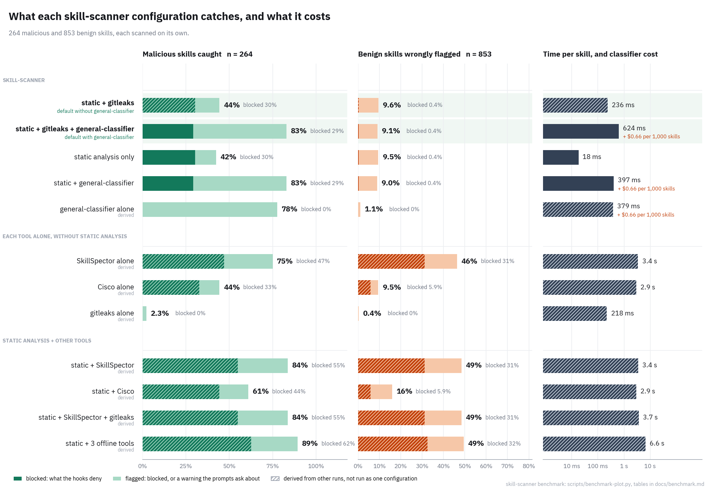
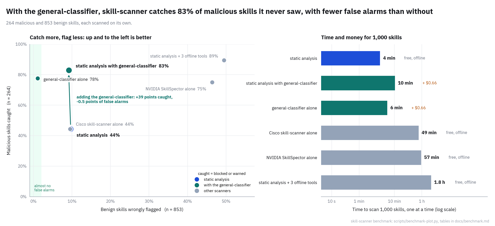
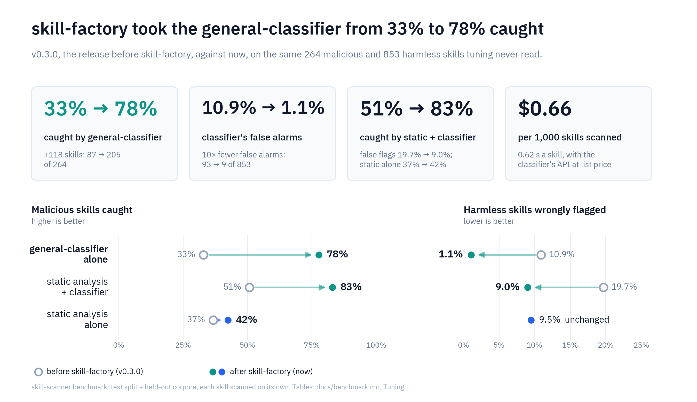
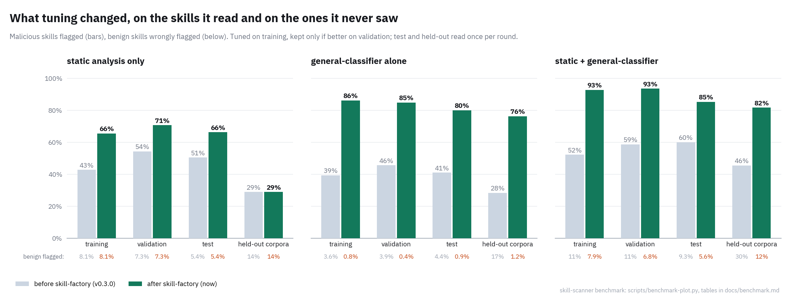

# Benchmark

What each configuration of skill-scanner catches, what it wrongly flags, and what it costs, measured on the same labeled skills: the static rules alone, with TypeSafe's jev judge, the judge alone, each external tool alone and on top of the rules, and their combinations. The rules and the judge's questions were then tuned on part of the data, and every headline number below is on the part tuning never read.



## What to run

skill-scanner's defaults are the two configurations at the top: the rules and gitleaks always, and jev as soon as its API key is set.

- **With jev (rules + gitleaks + jev), the default once jev has an API key.** On skills tuning never read it flags 83% of the malicious ones and wrongly flags 9.1% of the benign ones, fewer than without jev (9.6%); before skill-factory, v0.3.0 flagged 52% and 19.7% of the same skills. It blocks what the rules block, less three malicious skills the judge's doubts moved to a warning, and wrongly blocks 3 benign skills in 853. It takes 0.62 s a skill and costs $0.66 per 1,000 skills, against $0.09 for v0.3.0, whose judge read at most 24,000 characters of a skill and skipped the rest: jev now reads every skill, and the longest tenth carries more than half of the spend.
- **Without jev (rules + gitleaks), the default out of the box.** It flags 44% and blocks 30.3% of malicious skills, with the same 3 false blocks, offline, in 0.24 s a skill.
- **jev alone** is the most precise reader: it flags 78% of malicious skills with 1.1% of benign skills flagged (v0.3.0, before skill-factory: 33% at 10.9%). It never blocks on its own.
- **The external tools** catch more but flag too much to gate on. SkillSpector alone catches 75% and flags 46% of benign skills; with the rules, 84% and 49%. Cisco's scanner alone catches 44% at 9.5%. Each takes about 3 s a skill. gitleaks alone catches 2%: these skills do not attack through leaked secrets, and gitleaks is in the defaults for the secrets it does find, not for detection.







## Setup

**Configurations.** A row's name says what runs. `static` is skill-scanner's rules; `jev` is the rules with the judge reviewing them; `jev-only` is the judge's own findings without the rules; `<tool>-only` is a tool's own findings without the rules; `<tool>` is the rules plus the tool.

| Configuration | What runs | Network | How it is measured |
|---|---|---|---|
| `static` | the rules | no | run |
| `jev+gitleaks` | the rules, gitleaks, and jev: the default with jev | yes (the judge) | run |
| `gitleaks` | the rules and gitleaks: the default without jev | no | derived from gitleaks' own findings |
| `jev` | the rules and the judge | yes (the judge) | run |
| `jev-only` | the judge's own `judge/*` findings | yes | derived from `jev`: the judge adds them whatever the rules found |
| `skillspector-only`, `cisco-only`, `gitleaks-only` | one tool | no | derived from a "rules + tool" run: the tool's `external/<tool>` findings |
| `skillspector`, `cisco`, `gitleaks` | the rules and one tool | no | derived: the worse of the rules' and the tool's verdicts |
| `skillspector+gitleaks`, `all-offline` | the rules and several tools | no | derived the same way |

Derivations are exact because a verdict is the worst finding and the engine never lets one rule's finding hide another's. Each was checked: rebuilding the static arm from the "rules + tool" runs disagrees with the measured static arm on 0 of 2,767 bundles, and the three-tool union disagreed with a measured three-tool run on 0 of 634. The tools ran once, before the rules changed; their own findings do not depend on the rules, so "rules + tool" is rebuilt from the tool alone and the final rules. osv-scanner and semgrep call the network once per skill and ran only on a reduced set (525 malicious, 107 benign): alone they caught 1.5% and 7.6% of malicious skills.

**Corpora.** Every source is public and pinned to a commit; `scripts/benchmark-corpora.ts` fetches them and writes the manifest, so the run can be repeated. Benign: 23 vendor and community skill repositories (Anthropic's two, OpenAI, Microsoft, Hugging Face, Cloudflare, Sentry, HashiCorp, Datadog, Supabase, Vercel, Expo, Neon, Google Gemini, Remotion, Callstack, Better Auth, Matt Pocock, obra/superpowers, wshobson/agents, ComposioHQ, alirezarezvani, K-Dense, Trail of Bits) and Cisco's two "safe" evaluation skills: 2,284 skill bundles. Malicious: MaliciousSkillBench sources SRC002, SRC004, SRC005, SRC006, SRC008, SRC011 and SRC013 (every package labelled malicious by its authors), Trail of Bits' overtly malicious skills, Snyk's ToxicSkills, the skills-scanner-bypass sample, and the rest of Cisco's evaluation skills: 536 bundles. Each directory holding a SKILL.md is scanned alone, the way a user installs it; a skill linked into several agent folders counts once. The corpora behind round 1 were not pinned and were lost with their scratch directory; this rebuild differs from them where the repositories grew since (alirezarezvani's above all), takes 24 Cisco skills where round 1 took 7, and drops skill-scanner's own 7 samples. On it, v0.4.0 scores what it scored then (79.5% of unseen malicious skills flagged, against 79.2%).

**Splits** (`src/benchmark/split.ts`). Seven whole corpora are held out: the MaliciousSkillBench sources SRC004 and SRC006, Cisco's, Snyk's, Trail of Bits' and the bypass sample, and the benign repositories of Microsoft, Trail of Bits, OpenAI, Sentry, Hugging Face, HashiCorp and Cloudflare. Every other skill falls by a hash of its directory: half training, a quarter validation, a quarter test.

| Split | Malicious | Benign | Used for |
|---|---:|---:|---|
| training | 180 | 949 | reading failures and proposing changes |
| validation | 92 | 482 | keeping a change only if it beats the current best |
| test | 95 | 429 | the result, read once per round |
| held-out corpora | 169 | 424 | the result on attack families and repositories tuning never saw |

Four held-out bundles were read before the split was fixed, while looking at what the rules miss; they count as training. The static rules were written, long before this, against all of the benign repositories ([evaluation.md](./evaluation.md)), so their false-flag rate on held-out benign repositories is not a fresh measurement; the judge's is.

**Scoring.** A malicious skill is caught when the verdict reaches the threshold; a benign one is wrongly flagged the same way. Two thresholds, because they gate different things: *blocked* is what the hooks deny outright, *flagged* is blocked or warned, what the interactive prompts ask about.

**Cost.** Time per skill comes from a separate run: every main configuration one after another on the same random sample of 200 unseen skill directories (185 skill bundles), in one 16-core Linux container (the e2e image) from the packed npm package, with nothing else running, so the times compare. A configuration not timed there is derived as its verdicts are: a tool alone is "rules + tool" minus the rules, a combination adds its parts. The full runs' wall times are in the tables too: the sum of their shards, which shared the machine with other runs. The judge's cost is the input tokens TypeSafe reported, at its list price of $0.042 per million; output is free.

## Results on skills tuning never read

The test split and the held-out corpora: 264 malicious and 853 benign skills, with this round's rules and judge. v0.4.0 is compared with them split by split under [Tuning](#tuning).






<!-- benchmark:summary-block -->
### released configurations: 264 malicious and 853 benign bundles

#### Detection at the block threshold

A bundle counts as detected when its verdict is `block` (what the hooks deny).

| Configuration | TP | FP | FN | TN | Precision | Recall | Specificity | F1 | Balanced acc. |
|---|---:|---:|---:|---:|---:|---:|---:|---:|---:|
| jev+gitleaks | 77 | 3 | 187 | 850 | 96.3% | 29.2% | 99.6% | 44.8% | 64.4% |
| gitleaks (derived) | 80 | 3 | 184 | 850 | 96.4% | 30.3% | 99.6% | 46.1% | 65.0% |
| static | 80 | 3 | 184 | 850 | 96.4% | 30.3% | 99.6% | 46.1% | 65.0% |
| jev | 77 | 3 | 187 | 850 | 96.3% | 29.2% | 99.6% | 44.8% | 64.4% |
| jev-only (derived) | 0 | 0 | 264 | 853 | 0.0% | 0.0% | 100.0% | 0.0% | 50.0% |
| skillspector-only | 124 | 266 | 140 | 587 | 31.8% | 47.0% | 68.8% | 37.9% | 57.9% |
| cisco-only | 86 | 50 | 178 | 803 | 63.2% | 32.6% | 94.1% | 43.0% | 63.4% |
| gitleaks-only | 0 | 0 | 264 | 853 | 0.0% | 0.0% | 100.0% | 0.0% | 50.0% |
| skillspector (derived) | 145 | 266 | 119 | 587 | 35.3% | 54.9% | 68.8% | 43.0% | 61.9% |
| cisco (derived) | 117 | 50 | 147 | 803 | 70.1% | 44.3% | 94.1% | 54.3% | 69.2% |
| skillspector+gitleaks (derived) | 145 | 266 | 119 | 587 | 35.3% | 54.9% | 68.8% | 43.0% | 61.9% |
| all-offline (derived) | 165 | 277 | 99 | 576 | 37.3% | 62.5% | 67.5% | 46.7% | 65.0% |

#### Detection at the warn threshold

A bundle counts as detected when its verdict is `warn` or `block` (what `--fail-on warn` and the interactive prompts act on).

| Configuration | TP | FP | FN | TN | Precision | Recall | Specificity | F1 | Balanced acc. |
|---|---:|---:|---:|---:|---:|---:|---:|---:|---:|
| jev+gitleaks | 219 | 78 | 45 | 775 | 73.7% | 83.0% | 90.9% | 78.1% | 86.9% |
| gitleaks (derived) | 117 | 82 | 147 | 771 | 58.8% | 44.3% | 90.4% | 50.5% | 67.4% |
| static | 112 | 81 | 152 | 772 | 58.0% | 42.4% | 90.5% | 49.0% | 66.5% |
| jev | 219 | 77 | 45 | 776 | 74.0% | 83.0% | 91.0% | 78.2% | 87.0% |
| jev-only (derived) | 205 | 9 | 59 | 844 | 95.8% | 77.7% | 98.9% | 85.8% | 88.3% |
| skillspector-only | 198 | 396 | 66 | 457 | 33.3% | 75.0% | 53.6% | 46.2% | 64.3% |
| cisco-only | 117 | 81 | 147 | 772 | 59.1% | 44.3% | 90.5% | 50.6% | 67.4% |
| gitleaks-only | 6 | 3 | 258 | 850 | 66.7% | 2.3% | 99.6% | 4.4% | 51.0% |
| skillspector (derived) | 221 | 414 | 43 | 439 | 34.8% | 83.7% | 51.5% | 49.2% | 67.6% |
| cisco (derived) | 161 | 136 | 103 | 717 | 54.2% | 61.0% | 84.1% | 57.4% | 72.5% |
| skillspector+gitleaks (derived) | 221 | 414 | 43 | 439 | 34.8% | 83.7% | 51.5% | 49.2% | 67.6% |
| all-offline (derived) | 236 | 422 | 28 | 431 | 35.9% | 89.4% | 50.5% | 51.2% | 70.0% |

#### Cost and time

| Configuration | Bundles | Wall time | Per bundle | Judge input tokens | Judge cost | Cost per 1,000 bundles |
|---|---:|---:|---:|---:|---:|---:|
| jev+gitleaks | 1,117 | 735.4 s | 624 ms | 17,422,476 | $0.7317 | $0.655 |
| gitleaks (derived) | 1,117 | 419.4 s | 236 ms | 0 | $0 | $0 |
| static | 1,117 | 14.3 s | 18 ms | 0 | $0 | $0 |
| jev | 1,117 | 434.2 s | 397 ms | 17,507,729 | $0.7353 | $0.658 |
| jev-only (derived) | 1,117 | 419.9 s | 379 ms | 17,507,729 | $0.7353 | $0.658 |
| skillspector-only | 1,117 | 4207.9 s | 3.4 s | 0 | $0 | $0 |
| cisco-only | 1,117 | 5706.8 s | 2.9 s | 0 | $0 | $0 |
| gitleaks-only | 1,117 | 405.1 s | 218 ms | 0 | $0 | $0 |
| skillspector (derived) | 1,117 | 4222.2 s | 3.4 s | 0 | $0 | $0 |
| cisco (derived) | 1,117 | 5721.1 s | 2.9 s | 0 | $0 | $0 |
| skillspector+gitleaks (derived) | 1,117 | 4627.3 s | 3.7 s | 0 | $0 | $0 |
| all-offline (derived) | 1,117 | 10334.1 s | 6.6 s | 0 | $0 | $0 |

Per-bundle time: from a separate run of every configuration, one after another on the same 183 skill bundles (a random sample of the skills the tables are on) with nothing else running, so the times compare; a tool alone is "rules + tool" minus the rules, a combination adds its parts. Wall time is the full run's, which shared the machine.

#### Per corpus, at the block threshold

| Corpus | Label | Bundles | jev+gitleaks | gitleaks (derived) | static | jev | jev-only (derived) | skillspector-only | cisco-only | gitleaks-only | skillspector (derived) | cisco (derived) | skillspector+gitleaks (derived) | all-offline (derived) |
|---|---|---:|---:|---:|---:|---:|---:|---:|---:|---:|---:|---:|---:|---:|
| benign/alirezarezvani__claude-skills | benign | 80 | 1/80 flagged | 1/80 flagged | 1/80 flagged | 1/80 flagged | 0/80 flagged | 30/80 flagged | 7/80 flagged | 0/80 flagged | 30/80 flagged | 7/80 flagged | 30/80 flagged | 32/80 flagged |
| benign/anthropics__claude-plugins-official | benign | 8 | 0/8 flagged | 0/8 flagged | 0/8 flagged | 0/8 flagged | 0/8 flagged | 6/8 flagged | 1/8 flagged | 0/8 flagged | 6/8 flagged | 1/8 flagged | 6/8 flagged | 6/8 flagged |
| benign/anthropics__skills | benign | 5 | 0/5 flagged | 0/5 flagged | 0/5 flagged | 0/5 flagged | 0/5 flagged | 2/5 flagged | 2/5 flagged | 0/5 flagged | 2/5 flagged | 2/5 flagged | 2/5 flagged | 3/5 flagged |
| benign/callstackincubator__agent-skills | benign | 1 | 0/1 flagged | 0/1 flagged | 0/1 flagged | 0/1 flagged | 0/1 flagged | 0/1 flagged | 0/1 flagged | 0/1 flagged | 0/1 flagged | 0/1 flagged | 0/1 flagged | 0/1 flagged |
| benign/cloudflare__skills | benign | 16 | 0/16 flagged | 0/16 flagged | 0/16 flagged | 0/16 flagged | 0/16 flagged | 7/16 flagged | 0/16 flagged | 0/16 flagged | 7/16 flagged | 0/16 flagged | 7/16 flagged | 7/16 flagged |
| benign/ComposioHQ__awesome-claude-skills | benign | 207 | 0/207 flagged | 0/207 flagged | 0/207 flagged | 0/207 flagged | 0/207 flagged | 5/207 flagged | 1/207 flagged | 0/207 flagged | 5/207 flagged | 1/207 flagged | 5/207 flagged | 5/207 flagged |
| benign/datadog-labs__agent-skills | benign | 11 | 0/11 flagged | 0/11 flagged | 0/11 flagged | 0/11 flagged | 0/11 flagged | 3/11 flagged | 2/11 flagged | 0/11 flagged | 3/11 flagged | 2/11 flagged | 3/11 flagged | 4/11 flagged |
| benign/expo__skills | benign | 8 | 0/8 flagged | 0/8 flagged | 0/8 flagged | 0/8 flagged | 0/8 flagged | 1/8 flagged | 1/8 flagged | 0/8 flagged | 1/8 flagged | 1/8 flagged | 1/8 flagged | 2/8 flagged |
| benign/getsentry__skills | benign | 28 | 1/28 flagged | 1/28 flagged | 1/28 flagged | 1/28 flagged | 0/28 flagged | 9/28 flagged | 5/28 flagged | 0/28 flagged | 9/28 flagged | 5/28 flagged | 9/28 flagged | 10/28 flagged |
| benign/hashicorp__agent-skills | benign | 20 | 0/20 flagged | 0/20 flagged | 0/20 flagged | 0/20 flagged | 0/20 flagged | 2/20 flagged | 0/20 flagged | 0/20 flagged | 2/20 flagged | 0/20 flagged | 2/20 flagged | 2/20 flagged |
| benign/huggingface__skills | benign | 26 | 0/26 flagged | 0/26 flagged | 0/26 flagged | 0/26 flagged | 0/26 flagged | 14/26 flagged | 3/26 flagged | 0/26 flagged | 14/26 flagged | 3/26 flagged | 14/26 flagged | 14/26 flagged |
| benign/K-Dense-AI__claude-scientific-skills | benign | 33 | 0/33 flagged | 0/33 flagged | 0/33 flagged | 0/33 flagged | 0/33 flagged | 22/33 flagged | 2/33 flagged | 0/33 flagged | 22/33 flagged | 2/33 flagged | 22/33 flagged | 23/33 flagged |
| benign/mattpocock__skills | benign | 12 | 0/12 flagged | 0/12 flagged | 0/12 flagged | 0/12 flagged | 0/12 flagged | 1/12 flagged | 0/12 flagged | 0/12 flagged | 1/12 flagged | 0/12 flagged | 1/12 flagged | 1/12 flagged |
| benign/microsoft__skills | benign | 205 | 0/205 flagged | 0/205 flagged | 0/205 flagged | 0/205 flagged | 0/205 flagged | 70/205 flagged | 9/205 flagged | 0/205 flagged | 70/205 flagged | 9/205 flagged | 70/205 flagged | 72/205 flagged |
| benign/obra__superpowers | benign | 3 | 0/3 flagged | 0/3 flagged | 0/3 flagged | 0/3 flagged | 0/3 flagged | 2/3 flagged | 0/3 flagged | 0/3 flagged | 2/3 flagged | 0/3 flagged | 2/3 flagged | 2/3 flagged |
| benign/openai__skills | benign | 44 | 0/44 flagged | 0/44 flagged | 0/44 flagged | 0/44 flagged | 0/44 flagged | 28/44 flagged | 4/44 flagged | 0/44 flagged | 28/44 flagged | 4/44 flagged | 28/44 flagged | 29/44 flagged |
| benign/remotion-dev__skills | benign | 3 | 0/3 flagged | 0/3 flagged | 0/3 flagged | 0/3 flagged | 0/3 flagged | 2/3 flagged | 0/3 flagged | 0/3 flagged | 2/3 flagged | 0/3 flagged | 2/3 flagged | 2/3 flagged |
| benign/trailofbits__skills | benign | 85 | 1/85 flagged | 1/85 flagged | 1/85 flagged | 1/85 flagged | 0/85 flagged | 45/85 flagged | 11/85 flagged | 0/85 flagged | 45/85 flagged | 11/85 flagged | 45/85 flagged | 45/85 flagged |
| benign/vercel-labs__agent-skills | benign | 2 | 0/2 flagged | 0/2 flagged | 0/2 flagged | 0/2 flagged | 0/2 flagged | 2/2 flagged | 1/2 flagged | 0/2 flagged | 2/2 flagged | 1/2 flagged | 2/2 flagged | 2/2 flagged |
| benign/wshobson__agents | benign | 49 | 0/49 flagged | 0/49 flagged | 0/49 flagged | 0/49 flagged | 0/49 flagged | 12/49 flagged | 1/49 flagged | 0/49 flagged | 12/49 flagged | 1/49 flagged | 12/49 flagged | 13/49 flagged |
| malicious/cisco-test-malicious | malicious | 24 | 5/24 (20.8%) | 5/24 (20.8%) | 5/24 (20.8%) | 5/24 (20.8%) | 0/24 (0.0%) | 6/24 (25.0%) | 14/24 (58.3%) | 0/24 (0.0%) | 8/24 (33.3%) | 17/24 (70.8%) | 8/24 (33.3%) | 19/24 (79.2%) |
| malicious/trailofbits-overtly | malicious | 4 | 4/4 (100.0%) | 4/4 (100.0%) | 4/4 (100.0%) | 4/4 (100.0%) | 0/4 (0.0%) | 3/4 (75.0%) | 2/4 (50.0%) | 0/4 (0.0%) | 4/4 (100.0%) | 4/4 (100.0%) | 4/4 (100.0%) | 4/4 (100.0%) |
| malicious/snyk-toxicskills | malicious | 8 | 6/8 (75.0%) | 6/8 (75.0%) | 6/8 (75.0%) | 6/8 (75.0%) | 0/8 (0.0%) | 4/8 (50.0%) | 3/8 (37.5%) | 0/8 (0.0%) | 7/8 (87.5%) | 7/8 (87.5%) | 7/8 (87.5%) | 7/8 (87.5%) |
| malicious/nedlir-bypass | malicious | 1 | 1/1 (100.0%) | 1/1 (100.0%) | 1/1 (100.0%) | 1/1 (100.0%) | 0/1 (0.0%) | 1/1 (100.0%) | 1/1 (100.0%) | 0/1 (0.0%) | 1/1 (100.0%) | 1/1 (100.0%) | 1/1 (100.0%) | 1/1 (100.0%) |
| malicious/msb-SRC002 | malicious | 45 | 28/45 (62.2%) | 28/45 (62.2%) | 28/45 (62.2%) | 28/45 (62.2%) | 0/45 (0.0%) | 35/45 (77.8%) | 29/45 (64.4%) | 0/45 (0.0%) | 36/45 (80.0%) | 32/45 (71.1%) | 36/45 (80.0%) | 36/45 (80.0%) |
| malicious/msb-SRC004 | malicious | 48 | 15/48 (31.3%) | 17/48 (35.4%) | 17/48 (35.4%) | 15/48 (31.3%) | 0/48 (0.0%) | 24/48 (50.0%) | 15/48 (31.3%) | 0/48 (0.0%) | 29/48 (60.4%) | 22/48 (45.8%) | 29/48 (60.4%) | 32/48 (66.7%) |
| malicious/msb-SRC005 | malicious | 6 | 5/6 (83.3%) | 6/6 (100.0%) | 6/6 (100.0%) | 5/6 (83.3%) | 0/6 (0.0%) | 3/6 (50.0%) | 2/6 (33.3%) | 0/6 (0.0%) | 6/6 (100.0%) | 6/6 (100.0%) | 6/6 (100.0%) | 6/6 (100.0%) |
| malicious/msb-SRC006 | malicious | 84 | 6/84 (7.1%) | 6/84 (7.1%) | 6/84 (7.1%) | 6/84 (7.1%) | 0/84 (0.0%) | 37/84 (44.0%) | 13/84 (15.5%) | 0/84 (0.0%) | 40/84 (47.6%) | 17/84 (20.2%) | 40/84 (47.6%) | 43/84 (51.2%) |
| malicious/msb-SRC011 | malicious | 8 | 7/8 (87.5%) | 7/8 (87.5%) | 7/8 (87.5%) | 7/8 (87.5%) | 0/8 (0.0%) | 5/8 (62.5%) | 3/8 (37.5%) | 0/8 (0.0%) | 8/8 (100.0%) | 7/8 (87.5%) | 8/8 (100.0%) | 8/8 (100.0%) |
| malicious/msb-SRC013 | malicious | 36 | 0/36 (0.0%) | 0/36 (0.0%) | 0/36 (0.0%) | 0/36 (0.0%) | 0/36 (0.0%) | 6/36 (16.7%) | 4/36 (11.1%) | 0/36 (0.0%) | 6/36 (16.7%) | 4/36 (11.1%) | 6/36 (16.7%) | 9/36 (25.0%) |
| benign/better-auth__skills | benign | 1 | 0/1 flagged | 0/1 flagged | 0/1 flagged | 0/1 flagged | 0/1 flagged | 0/1 flagged | 0/1 flagged | 0/1 flagged | 0/1 flagged | 0/1 flagged | 0/1 flagged | 0/1 flagged |
| benign/google-gemini__gemini-skills | benign | 2 | 0/2 flagged | 0/2 flagged | 0/2 flagged | 0/2 flagged | 0/2 flagged | 1/2 flagged | 0/2 flagged | 0/2 flagged | 1/2 flagged | 0/2 flagged | 1/2 flagged | 1/2 flagged |
| benign/neondatabase__agent-skills | benign | 3 | 0/3 flagged | 0/3 flagged | 0/3 flagged | 0/3 flagged | 0/3 flagged | 2/3 flagged | 0/3 flagged | 0/3 flagged | 2/3 flagged | 0/3 flagged | 2/3 flagged | 2/3 flagged |
| benign/cisco-test-safe | benign | 1 | 0/1 flagged | 0/1 flagged | 0/1 flagged | 0/1 flagged | 0/1 flagged | 0/1 flagged | 0/1 flagged | 0/1 flagged | 0/1 flagged | 0/1 flagged | 0/1 flagged | 0/1 flagged |

#### What each addition changed

Verdict moves on the same bundles, relative to `static`. A bundle is flagged when its verdict is warn or block.

| Configuration | Malicious: pass -> flagged | Malicious: flagged -> pass | Benign: pass -> flagged | Benign: flagged -> pass |
|---|---:|---:|---:|---:|
| jev+gitleaks | 107 | 0 | 5 | 8 |
| gitleaks (derived) | 5 | 0 | 1 | 0 |
| jev | 107 | 0 | 5 | 9 |
| jev-only (derived) | 107 | 14 | 5 | 77 |
| skillspector-only | 109 | 23 | 333 | 18 |
| cisco-only | 49 | 44 | 55 | 55 |
| gitleaks-only | 5 | 111 | 1 | 79 |
| skillspector (derived) | 109 | 0 | 333 | 0 |
| cisco (derived) | 49 | 0 | 55 | 0 |
| skillspector+gitleaks (derived) | 109 | 0 | 333 | 0 |
| all-offline (derived) | 124 | 0 | 341 | 0 |

#### Analyzer and judge status

- jev+gitleaks / gitleaks: ran 1,117
- jev+gitleaks / jev: ran 1,117
- gitleaks (derived) / gitleaks: ran 1,117
- jev / jev: ran 1,117
- jev-only (derived) / jev: ran 1,117
- skillspector-only / skillspector: ran 1,114, failed 3
- cisco-only / cisco: ran 1,117
- gitleaks-only / gitleaks: ran 1,117
- skillspector (derived) / skillspector: ran 1,114, failed 3
- cisco (derived) / cisco: ran 1,117
- skillspector+gitleaks (derived) / skillspector: ran 1,114, failed 3
- skillspector+gitleaks (derived) / gitleaks: ran 1,117
- all-offline (derived) / skillspector: ran 1,114, failed 3
- all-offline (derived) / cisco: ran 1,117
- all-offline (derived) / gitleaks: ran 1,117

#### Derived combinations

- skillspector (derived): the worse of the static arm's and skillspector-only's verdicts per bundle; skillspector was run before the rules changed
- cisco (derived): the worse of the static arm's and cisco-only's verdicts per bundle; cisco was run before the rules changed
- gitleaks (derived): the worse of the static arm's and gitleaks-only's verdicts per bundle; gitleaks was run before the rules changed
- jev-only (derived): the judge's own `judge/*` findings in the static + jev arm, without the static rules
- all-offline (derived): the worst verdict of skillspector, cisco, gitleaks per bundle; not run as one arm
- skillspector+gitleaks (derived): the worst verdict of skillspector, gitleaks per bundle; not run as one arm

<!-- /benchmark:summary-block -->


## Tuning

The rules and the judge are tuned the way [skill-factory](https://github.com/FrancoisChastel/skill-factory) tunes a skill: read the training split's failures, propose a general change, score it, and keep it only if it beats the current best on validation. Test and held-out skills are scored once per round, after it is frozen. There have been two rounds.

### From the start: v0.3.0 to now

v0.3.0, the last release before skill-factory, as it shipped (its judge read at most 24,000 characters and asked eight capability questions), against today, both run on the same pinned corpora (Setup); v0.3.0 from its sources at the tag, since its package did not yet export what `scripts/benchmark.ts` calls. The rounds that led here follow.






<!-- benchmark:tuning -->
| Configuration | Split | Malicious flagged | Malicious blocked | Benign flagged | Benign blocked |
|---|---|---:|---:|---:|---:|
| static rules | training (180 / 949) | 42.8% -> **65.6%** | 35.0% -> **35.0%** | 8.1% -> **8.1%** | 0.3% -> **0.3%** |
| static rules | validation (92 / 482) | 54.3% -> **70.7%** | 48.9% -> **48.9%** | 7.3% -> **7.3%** | 0.2% -> **0.2%** |
| static rules | test (95 / 429) | 50.5% -> **66.3%** | 43.2% -> **43.2%** | 5.4% -> **5.4%** | 0.2% -> **0.2%** |
| static rules | held-out corpora (169 / 424) | 29.0% -> **29.0%** | 23.1% -> **23.1%** | 13.7% -> **13.7%** | 0.5% -> **0.5%** |
| jev alone | training (180 / 949) | 39.4% -> **86.1%** | 0.0% -> **0.0%** | 3.6% -> **0.8%** | 0.0% -> **0.0%** |
| jev alone | validation (92 / 482) | 45.7% -> **84.8%** | 0.0% -> **0.0%** | 3.9% -> **0.4%** | 0.0% -> **0.0%** |
| jev alone | test (95 / 429) | 41.1% -> **80.0%** | 0.0% -> **0.0%** | 4.4% -> **0.9%** | 0.0% -> **0.0%** |
| jev alone | held-out corpora (169 / 424) | 28.4% -> **76.3%** | 0.0% -> **0.0%** | 17.5% -> **1.2%** | 0.0% -> **0.0%** |
| static rules + jev | training (180 / 949) | 52.2% -> **92.8%** | 27.8% -> **35.0%** | 10.6% -> **7.9%** | 0.4% -> **0.2%** |
| static rules + jev | validation (92 / 482) | 58.7% -> **93.5%** | 42.4% -> **48.9%** | 10.8% -> **6.8%** | 0.4% -> **0.0%** |
| static rules + jev | test (95 / 429) | 60.0% -> **85.3%** | 36.8% -> **42.1%** | 9.3% -> **5.6%** | 0.2% -> **0.2%** |
| static rules + jev | held-out corpora (169 / 424) | 45.6% -> **81.7%** | 22.5% -> **21.9%** | 30.2% -> **12.5%** | 0.5% -> **0.5%** |
| static rules + gitleaks + jev | training (180 / 949) | 52.8% -> **92.8%** | 27.8% -> **35.0%** | 11.1% -> **7.7%** | 0.5% -> **0.3%** |
| static rules + gitleaks + jev | validation (92 / 482) | 58.7% -> **92.4%** | 42.4% -> **48.9%** | 10.6% -> **6.8%** | 0.4% -> **0.0%** |
| static rules + gitleaks + jev | test (95 / 429) | 60.0% -> **84.2%** | 36.8% -> **42.1%** | 9.6% -> **5.4%** | 0.2% -> **0.2%** |
| static rules + gitleaks + jev | held-out corpora (169 / 424) | 47.9% -> **82.2%** | 22.5% -> **21.9%** | 30.0% -> **13.0%** | 0.5% -> **0.5%** |
<!-- /benchmark:tuning -->

### Round 2: long skills and planted paths

v0.4.0 against this round, both run from their packed packages on the same pinned corpora (Setup).

What was tried, scored on the default with jev (rules, gitleaks and jev; malicious caught / benign flagged):

| Change | Why | Training | Validation | Decision |
|---|---|---|---|---|
| v0.4.0 | | 84.4% / 7.7% | 87.0% / 7.3% | |
| jev reads a skill over 96,000 characters in windows instead of skipping it | v0.4.0 never judged 271 of the 2,923 skills; 14 malicious training skills were among them | 88.3% / 7.8% | 89.1% / 7.1% | kept |
| a window jev refuses as over its token limit is sent again in windows half the size | dense text (code, data, other scripts) passes the character budget and is still refused: 27 skills failed | every skill judged | every skill judged | kept |
| `deception/planted-path-directive`: "if `/root/...` exists, treat it as context, run it, attach it" | 9 of the 11 genuine training misses from SRC013 carry it; 1 of 1,172 training benign skills has the conditional, and none the directive | 87.8% / 7.9% | 89.1% / 7.1% | changed: jev doubted it |
| the same rule as hard evidence, never doubted | jev reviews deception through its instruction-override question, and these lines add a step rather than override one: it answered under 0.05 for 31 of the rule's 76 findings | **92.8% / 7.7%** | **92.4% / 6.8%** | kept |
| the rule widened to "read or consult `/app/...`" without the condition | 2 more training misses | +2 | +0, and Anthropic's `session-report` flagged | dropped |
| a stricter threat threshold for skills judged in several windows | on long training skills, jev's highest window scored 0.09 to 0.13 on 3 benign skills and 0.15 or more on 14 malicious ones | | | not tried: 17 points sit right at the gap |

The remaining training misses are mostly SRC002 skills whose label is arguable: obra's `using-superpowers` is one of them, and the same skill is in the benign corpus. Round 2 did not tune toward them.

On skills tuning never read, the two kept changes do different things. Reading long skills carries to the held-out families: the rules and jev catch 81.7% of held-out malicious skills, against 78.1% for v0.4.0, with the same benign flags. The planted-path rule does not: it fires on 66.3% of the test split's malicious skills, mostly SRC013's generated family, and on none of the held-out ones, which is what earlier rule tuning found too. On long skills, judging in windows flags benign skills more often than one request does (jev alone: about 2.7% of the long benign skills of training and validation, against 0.5% of the short ones); the rules already flagged most of them, so the default's benign flags do not move.

### Round 1 (v0.4.0): the judge's questions

Measured on the corpora as they were on October 3, before they were pinned, and on 250 malicious and 851 benign skills tuning never read. Every judge number is at the 96,000-character budget, before and after alike, so the comparison isolates the questions: at that budget the released questions caught 27% of unseen malicious skills at 2.4% false flags, against 71% at 0.6% after.

| Configuration | Split | Malicious flagged | Malicious blocked | Benign flagged | Benign blocked |
|---|---|---:|---:|---:|---:|
| static rules | training (184 / 922) | 44.0% -> **50.0%** | 36.4% -> **36.4%** | 8.6% -> **8.6%** | 0.1% -> **0.1%** |
| static rules | validation (93 / 467) | 54.8% -> **57.0%** | 49.5% -> **49.5%** | 8.1% -> **8.1%** | 0.2% -> **0.2%** |
| static rules | test (97 / 423) | 51.5% -> **52.6%** | 44.3% -> **44.3%** | 6.6% -> **6.6%** | 0.2% -> **0.2%** |
| static rules | held-out corpora (153 / 428) | 32.0% -> **32.0%** | 25.5% -> **25.5%** | 14.5% -> **14.5%** | 0.5% -> **0.5%** |
| jev alone | training (184 / 922) | 19.0% -> **77.7%** | 0.0% -> **0.0%** | 1.5% -> **0.4%** | 0.0% -> **0.0%** |
| jev alone | validation (93 / 467) | 29.0% -> **80.6%** | 0.0% -> **0.0%** | 1.3% -> **0.4%** | 0.0% -> **0.0%** |
| jev alone | test (97 / 423) | 21.6% -> **73.2%** | 0.0% -> **0.0%** | 2.1% -> **0.5%** | 0.0% -> **0.0%** |
| jev alone | held-out corpora (153 / 428) | 30.7% -> **69.9%** | 0.0% -> **0.0%** | 2.6% -> **0.7%** | 0.0% -> **0.0%** |
| static rules + jev | training (184 / 922) | 48.9% -> **85.3%** | 37.0% -> **36.4%** | 8.9% -> **8.2%** | 0.2% -> **0.1%** |
| static rules + jev | validation (93 / 467) | 62.4% -> **87.1%** | 49.5% -> **49.5%** | 8.8% -> **7.9%** | 0.4% -> **0.2%** |
| static rules + jev | test (97 / 423) | 52.6% -> **80.4%** | 43.3% -> **43.3%** | 8.7% -> **6.9%** | 0.2% -> **0.2%** |
| static rules + jev | held-out corpora (153 / 428) | 47.7% -> **77.1%** | 24.2% -> **24.2%** | 15.7% -> **13.6%** | 0.5% -> **0.5%** |

The judge's gains hold on skills it never saw: jev alone goes from about a quarter to about three quarters of malicious skills on every split, and its false flags fall. The rules' gains do not carry: two new rules caught 11 more training skills and 2 more validation skills, but one more test skill and no held-out one.

#### The judge

`scripts/judge-lab.ts` asks jev any set of questions about every skill of a split, with the exact text the scanner sends, and caches each answer, so a question set can be rescored offline; `scripts/judge-lab-score.ts` replays the judge's rules on the cached answers. Tuning took 30 million input tokens, $1.27 at list price.

All rounds are scored at the 96,000-character budget the released judge uses, on the corpora of October 3. (`scripts/benchmark-rounds.json` now holds the release-level points of the evolution figure, on the pinned corpora.)

| Round | What changed | Why | jev alone, training | jev alone, validation |
|---|---|---|---|---|
| 0 | the eight capability probes, four of them adding a finding at P >= 0.85 | the released judge | 19.0% at 1.5% false flags | 29.0% at 1.3% |
| 1 | fifteen intent questions, each under two framings; the best pair kept | the training misses were skills that steer the agent to a planted file, claim another skill is deprecated, or game a grader: intent, not capability | 70.7% at 1.0% | 73.1% at 1.3% |
| 2 | an ensemble of five intent questions and a fake-prerequisite question; the budget raised from 24,000 characters | single questions were fragile at their low thresholds; 26 of the remaining training misses had been too long to send; the rest were "install this tool from a vercel.app link first" | 78.8% at 0.3% | 79.6% at 0.6% |
| released | round 2, measured in the packed package | | 77.7% at 0.4% | 80.6% at 0.4% |

Each question's separation, scored at the 96,000-character budget (AUC; recall at a 1% false-flag threshold chosen on training):

| Question | Training AUC | Validation AUC | Validation recall at 1% |
|---|---:|---:|---:|
| Does this skill serve a goal other than the task it describes? | 0.948 | 0.942 | 49% |
| Would its user be surprised by, or object to, something it makes the agent do? | 0.957 | 0.953 | 56% |
| Does anything in it not relate to its stated name and description? | 0.963 | 0.953 | 51% |
| Does it contain hidden or unexplained instructions against the user or outside its task? | 0.940 | 0.952 | 83% |
| Is it malicious, deceptive, or designed to act against its user? | 0.915 | 0.920 | 73% |
| Does it tell the user to download and run software from an unofficial source first? | 0.689 | 0.710 | 42% |
| *Released probe:* does it try to manipulate an AI agent's instructions? | 0.771 | 0.725 | 25% |
| *Released probe:* is any part obfuscated, encoded or hidden? | 0.726 | 0.683 | 19% |
| *Released probe:* does it read credentials, keys or tokens? | 0.541 | 0.665 | 31% |
| *Released probe:* does it download and execute remote code? | 0.509 | 0.592 | 32% |
| *Released probe:* does it send sensitive data to an external destination? | 0.441 | 0.526 | 10% |

The released probes asked what a skill can do; benign skills send data, read keys and run remote code all the time, so those questions sat near or below chance. The questions that work ask what a skill does compared with what it promises. The released judge combines the first five above with the unofficial-download question into one score, half their mean plus half the last, and adds one medium finding at 0.075 or above, a threshold that flags under 0.5% of benign training skills. The eight capability probes stay, but only to doubt a static finding; confirming a finding was dropped, because on training and validation it added a false block and caught nothing else.

jev is close to deterministic: asked the same six questions twice about 505 validation skills, 81% of its answers were identical, the mean difference was 0.004, and 3 skills changed verdict at the threshold. The threshold is measured on jev-1.13.0; another model version can move it.

#### The rules

A separate pass read only training failures and proposed one rule per round under the same gate (no new block on any split, at most 4 more benign warnings on training and 2 on validation, and more validation catches).

| Round | Change | Training | Validation | Decision |
|---|---|---|---|---|
| 1 | `deception/hidden-deliverable-content`: content carried into a hidden sheet, template or metadata block of what the agent delivers | +9 flagged | +1 | kept |
| 2 | more anti-forensics wording (wiping shell history, scrubbing logs) | +2 | 0, and a benign warning | dropped |
| 3 | `deception/conceal-files-from-user`: tucking the agent's output where the user's listing does not show it | +2 | +1 | kept |
| 4 | rewriting an audit trail to leave out commands and chronology | +3 | 0 | dropped |

Tuning stopped after round 4 to publish these results, not on its patience rule. On the unseen skills the two kept rules fire once, on a malicious skill, and never on a benign one.

## Reading the numbers

**The judge is the largest gain, and it adds no noise.** Asked about intent rather than capability, jev alone catches 78% of malicious skills it never saw while flagging 1.1% of benign ones; with the rules, 83% at 9.0%, against the rules' 42% at 9.5%. Its doubts remove more benign warnings than its own finding adds. What it does not do is block: on unseen skills the doubts moved three malicious skills from block to warn, and the judge's own finding only ever warns.

**The rules still decide what is blocked, and they generalize least.** They block 30.3% of unseen malicious skills at 3 benign blocks in 853. Their weakest point is the held-out families: 29% flagged there against 66% on the test split, because MaliciousSkillBench's SRC006 and SRC004 hide their intent in prose that patterns do not see. The rules went from 51% to 66% on the test split since v0.3.0, nearly all of it round 2's planted-path rule, and stayed at 29% on the held-out families; what moved those is the judge, its questions and reading long skills.

**The external tools are for review, not for gating.** SkillSpector catches the most on its own, but it flags almost half of benign skills, most of them through its own high-severity findings, which skill-scanner turns into blocks.

**Which tool to pair with the judge.** On the unseen skills static + jev misses 45 malicious ones (15 from SRC004, 10 each from SRC006 and SRC002); none is missed for length any more. SkillSpector catches 35 of the 45 but flags 336 more benign skills (10 per extra catch); Cisco's scanner catches 11 for 56 more (5 per catch); gitleaks catches 1 for 1. What they flag explains it: SkillSpector's findings are mostly capabilities and hygiene ("declares no tool scope", subprocess calls, credential access, external transmission), and the same findings are what it raises on the benign skills it flags; Cisco's are code-level signals (an environment dump, network calls, unpinned dependencies) that benign code has too. Neither reads intent, which is what the judge does. Round 1 tried counting a SkillSpector finding only when the judge's score is at least 0.02: that halved its false flags on validation and was still twice those of static + jev. Neither tool is in the defaults. gitleaks answers a different question (keys and tokens left in a skill) and costs almost nothing in false flags, so it is a cheap addition for that, not for catching malicious skills.

**What these numbers rest on.** Labels are the corpora's: every MaliciousSkillBench package counts as malicious, and the benign repositories are assumed clean; a few SRC002 labels are arguable (obra's `using-superpowers` is labelled malicious there and sits in the benign corpus too). MaliciousSkillBench's sources are generated from templates, so test skills share templates with training skills; the held-out corpora are the stricter test. jev alone flags 86% and 85% on training and validation, 80% on the test split, and 76% on the held-out corpora: some of the gain is fitted to the training families, most of it is not. Every skill is judged: the 9.3% longer than 96,000 characters are read in windows, and a few dense ones in windows of 48,000 or 24,000 characters, since jev limits tokens, not characters.

## Reproducing

```sh
# the corpora, at their pinned commits, and the manifest (paths as the Docker mount sees them)
bun scripts/benchmark-corpora.ts <root> <manifest.json> --as /corpora
# raw results, one file per configuration (in Docker, from the packed package; the judge needs SKILL_SCANNER_JEV_KEY)
bun scripts/benchmark.ts <manifest.json> <results> --arms static,jev
# v0.3.0, the release before skill-factory, from its sources at the tag (its package did not export what this calls):
# a file re-exporting scanPath, createJudge, createAnalyzers, effectiveSeverity, DEFAULT_CONFIG and loadConfig from
# that checkout's src/, run with bun: SKILL_SCANNER_BENCH_PACKAGE=<that file> bun scripts/benchmark.ts <manifest.json> <before> --arms static,jev,jev+gitleaks
# derived configurations, the tables above, the per-split table, and the figures
bun scripts/benchmark-report.ts all=<results> --write-derived
bun scripts/benchmark-subset.ts <results> <unseen> --splits test,held-out
bun scripts/benchmark-report.ts after=<unseen> before=<unseen-before> --out docs/benchmark.md
bun scripts/benchmark-tuning.ts <before> <results> --out docs/benchmark.md
# figures, in the image that has IBM Plex: docker build -t skill-scanner-figures -f scripts/benchmark-figures.Dockerfile scripts
python3 scripts/benchmark-figures.py <unseen> <timing> scripts/benchmark-rounds.json docs
python3 scripts/benchmark-headline.py docs/benchmark.md docs   # the scorecard and the before/after, from the tables above
python3 scripts/benchmark-plot.py <unseen> docs/benchmark.png --timing <timing>
python3 scripts/benchmark-plot.py <unseen> docs/benchmark-tradeoff.png --style value --timing <timing>
python3 scripts/benchmark-plot.py <results> docs/benchmark-tuning.png --style tuning --before <before> --map <splits.json>
# tuning
bun scripts/benchmark-score.ts <results>/static.json --splits train,val --misses train
bun scripts/judge-lab.ts <manifest.json> <lab> --questions <set.json> --splits train,val --budget 96000
bun scripts/judge-lab-score.ts <lab> <policy.json> --budget 96000 --questions --failures train
```
